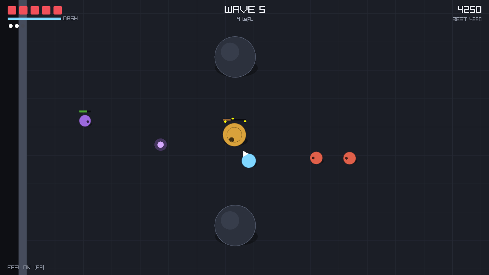
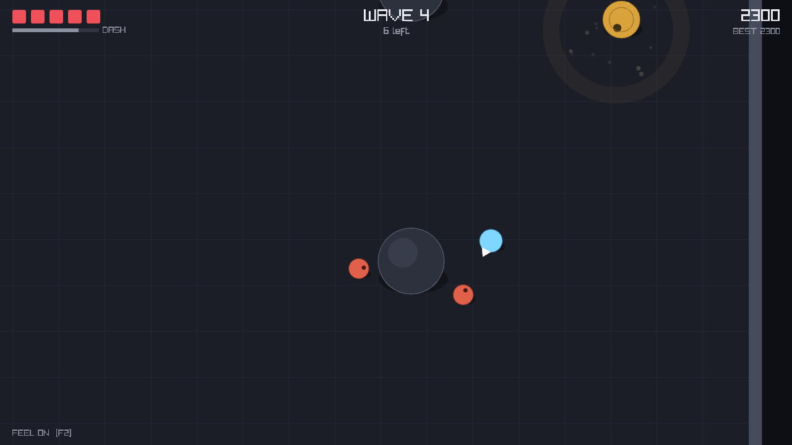

# Ironclad Arena

A top-down arena action game in C++20 and [raylib](https://www.raylib.com/). Survive waves of enemies with a three-hit melee combo, a ranged shot and a dash with invulnerability frames. Every enemy attack is telegraphed and followed by a punish window, so the game is about reading attacks and answering them.

The point of the project is the systems underneath: a fixed-timestep deterministic simulation, movement and combat feel you can switch off to compare, finite-state-machine enemies, a uniform-grid broad phase, and pooled memory, all in a core library with no engine and no raylib dependency, covered by tests.



| | |
|---|---|
|  | **Enemies** (all in `data/game.cfg`)<br>**Grunt** closes fast, telegraphs, then lunges in a direction it locked at the start of the windup.<br>**Spitter** keeps its distance, circles, and stops aiming just before it fires.<br>**Brute** is slow and heavy; a long windup into a ground slam. Only the finisher or sustained damage staggers it. |

## Controls

| Action | Keyboard / mouse | Gamepad |
|---|---|---|
| Move | WASD / arrows | Left stick |
| Aim | Mouse | Right stick |
| Melee (3-hit combo) | Left click / J | X |
| Shoot (hold) | Right click / K | RT |
| Dash (invulnerable) | Space / Shift | A / LB |
| Pause | Esc / P | |
| Debug overlay · feel on/off · mute · reload data | F1 · F2 · F3 · F5 | |

## Systems

### Fixed timestep and determinism
`World::Step()` advances exactly 1/60 s from one `PlayerInput`. `FixedTimestep` accumulates real time in integer nanoseconds, runs as many steps as fit, caps the catch-up at 8 steps after a stall, and the renderer interpolates every entity between its previous and current position. The simulation uses its own SplitMix64 generator, and cosmetic effects (particles) use a *second* generator, so adding a spark never changes where the next enemy spawns. A test runs 90 seconds of scripted play twice and compares state hashes every second; another fills the particle pool in one of two worlds and checks that gameplay still matches exactly.

### Game feel, and a switch to turn it off
Press **F2** to toggle all four together and feel the difference:
- **Acceleration and friction**: speed ramps toward the stick (2,600 u/s²) and stops faster than it starts (3,200 u/s²). Off: velocity snaps.
- **Input buffering**: a melee or dash press up to 120 ms early is kept and fires the moment it becomes possible, which is what makes the combo chain cleanly. Off: an early press is lost (there's a test for exactly that).
- **Hitstop**: the fight freezes for 3 to 6 ticks on a hit, kill or hurt. Presses made during the freeze are still buffered.
- **Screen shake**: trauma-based (shake = trauma²), decaying, from hits, kills, slams and damage.

Plus the parts that don't switch off: dash i-frames that last a little longer than the dash, dash cancelling a swing's recovery, a small lunge into each swing, telegraphs drawn and voiced (a rising tick on every windup), hit flashes, and a heavier finisher.

### Enemies: finite-state machines
`Spawning → Chase → Windup → Attack → Recover → Chase`, with `Stagger` interrupting anything when a hit breaks poise. The brain (`EnemyBrain.cpp`) only decides: desired velocity, when a windup starts, when the attack lands. `World` moves the enemy and applies the attack. Crowds spread out through separation steering while chasing, plus a positional overlap pass that also covers enemies mid-attack. That pass came from a failing test: the first version only separated chasing enemies, so grunts winding up next to the player stacked on top of each other. Enemies steer around pillars by turning the part of their velocity that points into a pillar into a tangent.

### Broad phase: a uniform grid built by counting sort
`SpatialGrid` is rebuilt every tick: count items per cell, prefix-sum the counts into offsets, scatter the items into one flat array. Each cell's items are contiguous, insertion order is kept (so queries are deterministic), and nothing is allocated after setup. Melee arcs, projectile hits and separation all query it.

Finding every overlapping pair among N circles of radius 14 in the 1600×960 arena, brute force vs grid (build + query), median of 11 to 51 runs, MSVC Release, Intel Core i5-14400F, one thread (`bench_spatial`):

| Circles | Overlapping pairs | Brute force (ms) | Grid build + query (ms) | Speed-up |
|---:|---:|---:|---:|---:|
| 100 | 6 | 0.003 | 0.002 | 1.6× |
| 250 | 47 | 0.020 | 0.004 | 4.9× |
| 500 | 191 | 0.079 | 0.008 | 9.8× |
| 1,000 | 798 | 0.310 | 0.042 | 7.3× |
| 2,000 | 3,114 | 1.231 | 0.175 | 7.0× |
| 4,000 | 12,556 | 4.988 | 0.522 | 9.5× |
| 8,000 | 50,197 | 19.908 | 1.595 | 12.5× |

Both methods must report the same pair count or the benchmark exits with an error. At the game's real scale (at most 160 enemies) the whole broad phase is a few microseconds either way; the grid matters because it keeps the cost flat as waves grow. The speed-up isn't monotonic (500 → 1,000 drops); at these sizes the timings are small enough that cache effects and noise show through.

### Memory
Enemies, projectiles and particles live in fixed-capacity `Pool<T, N>`s with generational handles (a handle to a freed slot stops resolving instead of pointing at the slot's next occupant). The grid, the event list and the spawn queue are sized in the constructor. `tests/test_alloc.cpp` replaces global `operator new` in the test binary and counts calls across three minutes of simulated waves. In the game, the F1 overlay shows C++ allocations per frame and the most in any frame of the current wave.

### Data-driven tuning
`data/game.cfg` holds the player tuning, every enemy type and the wave list. The parser is strict: an unknown key, a bad number, a misspelled enemy in a wave, or a missing value fails with the line number and section. Press **F5** in game to reload it. After the last defined wave the game repeats it with more enemies and 15% more HP each time.

### Debug overlay (F1)
Frame-time graph against the 16.7 ms line, simulation ticks run this frame, entity counts against pool capacity, allocations, the state hash, collision circles, the melee arc, grid-cell occupancy and every enemy's state label.

## Building

Needs CMake 3.24+ and a C++20 compiler (tested with MSVC 2026 / Visual Studio 18). raylib 5.5 and doctest are fetched by CMake.

```bash
cmake -S . -B build
cmake --build build --config Release
build/Release/ironclad_arena.exe          # game
build/Release/arena_tests.exe             # tests
build/Release/bench_spatial.exe           # benchmark
```

`-DARENA_BUILD_GAME=OFF` builds only the core, tests and benchmark (no raylib), which is what CI runs on Ubuntu and Windows.

Command-line options: `--autoplay` (a bot plays), `--seed N`, `--feel-off`, `--debug`, `--size 1280x720`, `--mute`, `--frames N`, `--shot FRAME PATH`, `--record DIR` (every frame at exactly 1/60 s, for making clips).

## Layout

```
core/include/arena/   Math (Vec2, Rng), Pool, FixedTimestep, SpatialGrid,
                      Config, GameData, PlayerMotor, EnemyBrain, World
core/src/             their implementations (no raylib)
game/                 raylib layer: main loop and input, Render, Audio
                      (all sounds synthesized at startup), Autopilot, AllocCounter
tests/                doctest suite
bench/                spatial grid benchmark
data/game.cfg         all tuning
```

## Known limits
- Enemy pathing is local steering only; an enemy can briefly hug a pillar before sliding around it.
- Determinism is per build: the same binary replays identically, but different compilers or floating-point settings can diverge.
- Placeholder art is drawn from shapes; the default raylib font is used.
